# Trend Radar

## Added in this fork: Jev + Treg skills for ecom and ads

This fork adds two skills under `mod/skills/`:

| Skill | What it does |
|---|---|
| [`jev-treg-ecom-research`](mod/skills/jev-treg-ecom-research/SKILL.md) | Pull TikTok trending/product videos, search suggestions and Amazon search volume through treg, label every row cheaply with TypeSafe Jev (System One), rank by engagement and TikTok Shop signals. |
| [`jev-treg-ads-intel`](mod/skills/jev-treg-ads-intel/SKILL.md) | Read-only competitor ad research from the Meta and TikTok ad libraries through treg, classified by Jev (hook, format, offer, relevance), ending in a creative brief for a human. Never touches ad accounts or spend. |

Pattern: treg fetches, Jev judges, code ranks, the expensive agent only writes the brief.

Forked from [mrdainami/trend-radar-mod](https://github.com/mrdainami/trend-radar-mod) (Apache-2.0). Original work by Calvin Hia.


What to make next on YouTube, with proof. And the thumbnail.

Trend Radar watches your competitors, finds their videos that broke out, reads what just launched on X, and ranks 5 video ideas for you. Press one button more and it drafts a thumbnail with you in it. It runs inside Claude Code. The data comes through [treg](https://treg.to/?ref=cal-uhf7b): about 1 cent a run, about 1 cent a thumbnail.

## Set up in 5 steps

1. **Put this folder anywhere** and open it in Claude Code (the desktop app, or `claude` in a terminal inside the folder). Prefer to keep working in a bigger project? Then set the mod's **Trend Radar folder** setting to this folder (in `/config`, under the plugin's options). An opened radar folder always wins over that setting.
2. **Get treg.** [Sign up for treg](https://treg.to/?ref=cal-uhf7b), then in Claude go to Settings → Connectors → **Add custom connector**, name it `treg`, paste `https://treg.to/mcp` as the URL, press Add, then Connect and sign in.
3. **Install the mod.** In Claude, type these two lines, one after the other:
   ```
   /plugin marketplace add mrdainami/trend-radar-mod
   /plugin install trend-radar@trend-radar-mod
   ```
   You get the `/trend` command and the Trend Radar panel. (Installing from a downloaded folder instead of GitHub: use the folder's path in the first line.)
4. **Switch the mode picker off Auto** (under the chat box). Mods can't reach treg in Auto mode.
5. **Type `/trend setup`** and answer a few questions. Claude suggests your audience and pillars from your videos, finds 10 to 15 competitors, and asks for 1 to 4 photos of you for thumbnails. About 2 minutes, a few cents.

Then press **↻ Refresh** in the panel. Your first 5 ideas take about a minute.

## Every day after that

- **Ideas:** type `/trend`, or press Refresh. Open an idea for why now, the angle, and the proof.
- **Thumbnail:** open an idea, press 🖼 Thumbnail. Claude writes the brief in chat, you tweak it, say "generate". The picture lands in the panel and in the idea's folder.
- **Change anything by talking:** "add @channel to competitors", "note that I have a sponsor this month", "use this photo for thumbnails".

Everything else is in [MANUAL.md](MANUAL.md).

## What's in this folder

| | |
|---|---|
| `settings.json` | who this radar is for (setup fills it) |
| `references/` | your photos, for thumbnails |
| `ideas/` | one folder per idea you saved or made a thumbnail for |
| `presets/` | saved setups; one example included |
| `mod/` | the mod itself |

Made by [Calvin Hia](https://www.youtube.com/@calvinhia_ai). Version 1.0.0. Apache 2.0 license. Updates: `/plugin marketplace update trend-radar-mod`.
